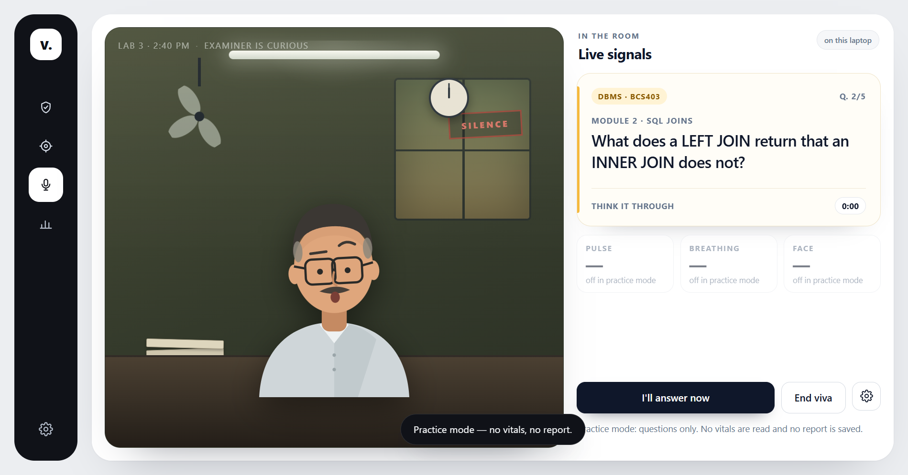

# Viva Mode

A lab-viva practice room for VTU CSE students. The examiner asks real questions from the 2022
scheme; the room softens as your breathing settles back toward your own baseline; afterwards you
get a private Calm Report.

Built with the [Presage SmartSpectra SDK](https://physiology.presagetech.com) for the SmartSpectra
SDK Challenge.



## What it does

- **Consent first.** The camera turns on only after you press the button. The screen explains what
  is read, what is stored, and what leaves the laptop.
- **60-second calibration.** SmartSpectra reads pulse, breathing and HRV while you sit still. The
  median of that window becomes *your* baseline — there is no good or bad number.
- **Five real questions.** The deck is drawn round-robin from Operating Systems (BCS303), Data
  Structures (BCS304), Design and Analysis of Algorithms (BCS401), DBMS (BCS403) and Computer
  Networks (BCS502).
- **An adaptive room.** When breathing runs above your baseline the room tightens: the tube light
  flickers, the fan spins, the props crowd in. As breathing settles the wall cools, the lamp warms
  and the examiner's mood changes. A pacer appears only when it can help.
- **A talking-driven answer phase.** Start answering whenever you like, or let the SDK's talking
  detector move you from *think* to *answer*. Breathing pauses while you speak; pulse keeps running.
- **Honest signals.** Each chip is gated on stability, confidence and range. Unreadable is shown as
  unreadable, never guessed.
- **A private Calm Report.** Session timeline, baseline comparison, one card per question, and a
  local examiner's remark. Export it as a PNG if you want to keep it.
- **Practice without signals.** Questions only, no camera, no report — useful in a lab with no
  webcam or when you do not want to share vitals.

## Privacy and data handling

- Frames are processed on this laptop by the SDK's native engine and are **never written to disk**.
- No video, frames, face landmarks or metric streams are stored.
- Per-question summaries are saved locally: think time, answer time, peak pulse vs your baseline,
  breathing while thinking, and whether you settled.
- The API key is encrypted with the OS keychain through Electron `safeStorage`.
- The only network call is to Presage, to validate the key and compute metrics. There is no account
  and no cloud sync.
- SDK telemetry is **off by default**. When enabled it sends one aggregate session summary: SDK
  version, platform, frame throughput and counts of validation warnings. No frames, metric values or
  identifiers.
- **Settings → Delete all my data** removes sessions, reports and the saved key.

## Requirements

- Node.js 22 or newer
- Windows, macOS or Linux with a webcam for the live path
- A Presage API key from [physiology.presagetech.com](https://physiology.presagetech.com)

Practice mode works without a key or a camera.

## Setup

```bash
npm install
```

On Windows, npm 11 blocks install scripts by default. Approve the packages this app needs:

```bash
npm install-scripts approve koffi protobufjs esbuild
```

If the Electron binary download fails, use a mirror for that install:

```powershell
$env:ELECTRON_MIRROR = "https://npmmirror.com/mirrors/electron/"
npm install
```

## Run

```bash
npm start
```

Paste the Presage key on the consent screen, or set it in your shell before launching:

```powershell
$env:PRESAGE_API_KEY = "your-key"
npm start
```

You can also save the key in **Settings → Camera**. It is stored encrypted; it is never baked into
the bundle.

## Checks

```bash
npm run typecheck   # tsc --noEmit
npm test            # 19 camera-free tests
npm run smoke       # Electron: consent → practice → 5 questions → report → settings
npm run build       # esbuild bundles for main, preload and renderer
```

The smoke harness writes screenshots and `smoke/result.json`.

## How it is put together

```
src/main       Electron window, IPC, local storage, smoke harness
src/preload    sandboxed bridge between the renderer and the main process
src/renderer   DOM UI, examiner drawings, Chart.js report
src/shared     camera-free types, packet decoding, reducer, formatting
data           VTU CSE question bank
```

The renderer owns no policy. It decodes packets into a `Snapshot`, hands them to the reducer in
`src/shared/stateMachine.ts`, and paints whatever the reducer says. That split is what lets the
adaptive room be tested without a camera.

Two clocks are kept separate:

- `performance.now()` drives the state machine and the UI.
- SmartSpectra epoch-microsecond timestamps drive the EMA time step and packet de-duplication.

The SDK's `metrics` event carries only the window since the previous emit, so the app always takes
the newest sample in each array and never assumes the arrays are cumulative.

## Copy rules

- Always relative: “vs your baseline”, “settled back”, “a little higher than your baseline”.
- Never “stressed”, “anxious”, “unhealthy”, “abnormal”, or “your heart is…”.
- The report never diagnoses, treats, or compares you with anyone else.

**Wellness/practice tool. Not medical advice. SmartSpectra metrics are not FDA-cleared.**

## License

MIT. See [LICENSE](LICENSE).
